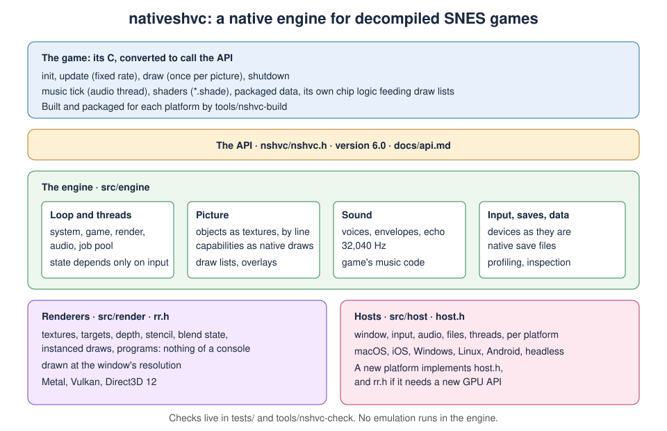

# nativeshvc - a true native Super Nintendo / Super Famicom

nativeshvc is a native engine for decompiled SNES games. It provides what the SNES provided, natively, with zero emulation.
A game uses it once its C is converted to native code calling nativeshvc's API. Games that are not converted can still be
played from their original ROM in any emulator.

It is to decompiled SNES games what Unity is to its games: a game writes against one API and builds for every platform the
engine supports.

**Maintainer:** Jeffrey Wilbur, Strut B, LLC\
**Contact:** [retro@strutb.com](mailto:retro@strutb.com)\
**Licence:** AGPL-3.0

The engine is at API 6.2. `docs/native-engine-plan.md` opens with what has and has not been run on each platform.



## What it provides

- **A loop.** The engine calls the game's `update` at the rate it chooses and its `draw` once per picture, telling it how far
  it is between two updates.
- **Threads.** System, game, render and audio threads, and a job pool. Game state depends only on the updates run and their
  input.
- **The picture, drawn natively on the GPU.** Layers, tiles, maps, palettes, sprites, windows, colour maths, mosaic,
  Mode 7, hires, direct colour and offset-per-tile, as the SNES had them, at any screen size, with per-line changes from a
  table of values. Each becomes native geometry and GPU state at the window's own resolution: tile layers and sprites are
  instanced quads, Mode 7 a textured plane (read through its smaller levels, by arithmetic, where it shrinks), priorities depth,
  windows stencil, per-line changes strips of rows; the colour maths are done where each layer's colour is written,
  exactly as the SNES defines them, so a picture is one pass into the window. Texels stay sharp, with only the pixel an
  edge falls in mixed, and edges are smoothed by 8 samples a pixel where the GPU has them, else 4 (`nshvc_draw_samples`
  sets a draw list's own). Nothing renders a console-sized picture. Backends: Vulkan, Metal and Direct3D 12.
- **The picture's shape in the window.** 4:3 by default, centred with black margins. A game can name another shape, such as
  8:7, or fill the window, and open its window at that shape. A wider screen keeps the original's pixel shape, and a game can
  say which part of it is shown.
- **A drawing pipeline.** A game's own triangles, lines and images, such as its 3D, drawn straight into the frame in a
  layer's place among the layers and sprites, with depth, and with game shaders compiled for every backend at build time;
  and instanced meshes: a model kept on the GPU, drawn at thousands of places a picture, projected in the vertex stage.
- **Sound.** Voices, envelopes, noise, pitch modulation and echo by the SNES's rules at 32,040 Hz, with the game's music code
  on the audio thread.
- **Input.** Every keyboard key, controller button, stick and trigger, the pointer and every finger on a touch screen,
  each as the device has it. The game decides what each one does.
- **Saves and game data.** Native files, written off the game's thread, and packaged assets.
- **Profiling and inspection.** Time per thread and per zone, and each picture's state on request.

## Using it

Read [docs/api.md](docs/api.md) for the contract and [docs/conversion-guide.md](docs/conversion-guide.md) to bring a game to
the engine, with a full game as a worked example. [examples/comet](examples/comet) is a complete small game that uses each part of
the engine; [`examples/`](examples) also holds a full commercial-scale game converted to the engine, with credit to its original authors.

| Tool | What it does |
|---|---|
| `tools/nshvc-find-hardware` | Lists what a game's C must change |
| `tools/nshvc-build PLATFORM GAME_DIR` | Builds and packages a game |
| `tools/nshvc-shaders SRC OUT [RENDER]` | Compiles a game's shaders for every backend (`nshvc_game` runs it) |
| `tools/nshvc-icons IMAGE OUT PLATFORM` | Makes a platform's icon from one square PNG (`nshvc_game` runs it for `ICON`) |
| `tools/nshvc-check` | Compares a converted game's sound with its ROM's in bsnes |

```bash
tools/nshvc-build macos path/to/game
```

Platforms: `headless`, `macos`, `ios`, `android`, `windows`, `windows-d3d12`, `linux`.

Android needs `ANDROID_HOME` and `ANDROID_NDK_HOME` and produces a signed APK. Building a game with shaders needs
`glslangValidator` and `spirv-cross` on the build machine, and `dxc` for D3D12 (other builds leave its shaders out).

## Running

```
game                                  in a window
game --headless --updates N           N updates, one picture each, no real time
     --updates N                      end after N updates
     --input FILE                     the devices by update number (docs/api.md section 7)
     --shots DIR                      each picture, as DIR/NNNNNN.ppm
     --sound FILE                     16-bit stereo at 32,040 Hz (headless)
     --inspect FILE                   each picture's state, each time F12 is pressed
```

## The SNES's limits

Limits are settings a game chooses: `nshvc_limits_set` for sprites per line, `nshvc_sound_limits_set` for voices and sample
memory. By default there are none.

## Checks

Build with `-DNSHVC_TESTS=ON`. `tests/scenes/feature.c` checks draw lists, shaders, images, overlays, saves, input replay
and jobs against values worked out by hand, and `tests/scenes/mesh.c` instanced meshes against the same triangles drawn
the other way, a wall of triangles, the near plane, kept and rewritten meshes and thousands of instances. `tests/oracle` runs a ROM in bsnes for `tools/nshvc-check`, which compares a
converted game's sound with the original's, and for `tests/scenes/scenes.py`, which makes each picture feature as a test ROM
and as a scene for the engine and compares the two byte for byte at the console's size. `m7check` measures Mode 7's
anti-aliasing against the console's lookup, and `cost` times the drawing case by case.

What has been run: headless, at the console's size, 116 scenes on Metal, on Vulkan on Linux (dzn, AMD), on Direct3D 12 on Windows
(AMD) and on Vulkan on Windows (AMD): on each, 112 match, 0 fail and 4 (rotated or scaled Mode 7, and Mode 7 whose scroll
changes by two texels a line) are listed as differing by design. The example game has been looked at on the iOS Simulator and
on the Android emulator, upright and turned, and is the picture the Mac draws. Not run: a window on Windows or Linux, a real
phone, a whole game. A game's pictures at the window's resolution are not compared with an emulator's.
