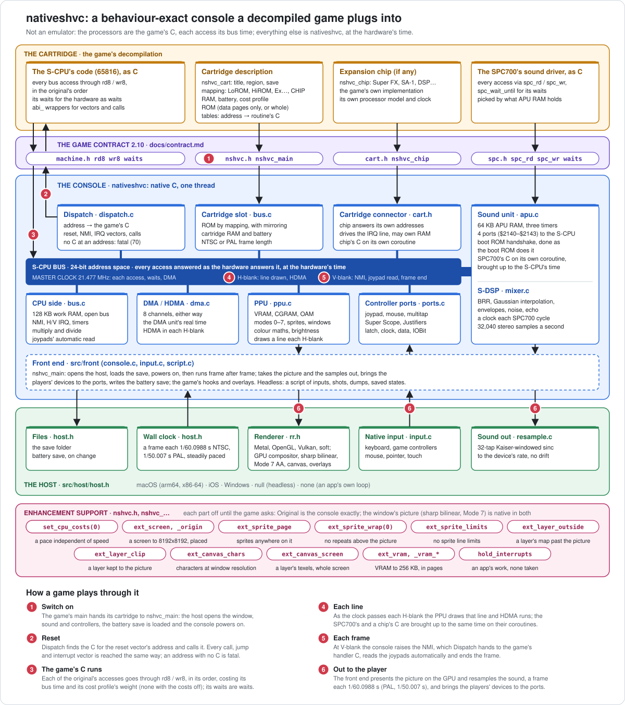

# nativeshvc: a native Super Famicom / Super Nintendo implementation

**nativeshvc is not an emulator.**

It is a behaviour-exact native implementation of the Super Famicom / Super Nintendo itself:
the console's bus, picture unit, sound unit, DMA, interrupts and controller ports, built as
native code for the host. Nothing in it interprets, translates or recompiles machine code:
there is no emulated 65816 or SPC700, no instruction loop and no ROM image of the game's
code. The game's own decompiled C runs directly on it, natively.

**Behaviour exact, not cycle exact.** Everything the console does, nativeshvc does as the
console does it, at the console's own time: the picture line by line, DMA and HDMA, the
interrupts, the timers, the sound chip's 32,040 samples a second, held to the reference
(bsnes) read for read, pixel for pixel and sample for sample. The game's processors are
its C, and their work takes no time: the C makes every access the original makes, in the
original's order, and waits where the original waited for the hardware. So the game does
what it did, and sees and plays what it saw and played; only how long its own processors
took is not kept (see [Time](#time)).

**A decompiled game is the cartridge; nativeshvc is the console it plugs into.** A game's
decompiled C, linked against nativeshvc, builds a native program that powers on, runs the
reset vector's code and plays as it did on the console: the same picture and the same
sound, with the console's own frame rate, and no emulated processor and no ROM image of the
code.

**Maintainer:** Jeffrey Wilbur, Strut B, LLC\
**Contact:** [retro@strutb.com](mailto:retro@strutb.com)

nativeshvc was created by Jeffrey Wilbur. It began as the machine layer of the native
[Stunt Race FX](https://github.com/jeff-strutb/stuntracefx) port, and was lifted out of it so
that every Super Nintendo decompilation can share one console instead of building its own.

## Project Purpose

A decompilation that is byte exact recovers the game's code, but code alone
does not play. On the console it sat in a machine: a bus that answers its addresses, a
picture unit drawing what it wrote, a sound chip, DMA, interrupts, a controller, a battery,
a television's frame rate. Each native port has had to rebuild all of that around its game.

nativeshvc builds it once. Its purpose is the equivalent of putting a cartridge in the
console and switching it on: a decompilation describes its cartridge, hands over its C, and
gets a native program that plays on any platform with a host (macOS and iOS now; Windows
and Linux to come), presented on the GPU at any window size, with sound, controllers and
saves, at the console's own pace.

It holds to the standard of the decompilations it serves. It runs no emulated CPU, does no
high-level emulation of the game, and has no per-game fixes. It is behaviour exact: the
game's own C makes every access the original makes, in the original's order, and waits
where the original waits for the hardware; nativeshvc answers each access as the hardware
does, and runs the hardware at the hardware's time. The C's own work takes no time (see
[Time](#time)).

Beyond the console, nativeshvc is also an unconstrained native Super Nintendo: the
console's numbers are its baseline, and a port may opt out of them (see
[Extensions](#extensions)).



## Using nativeshvc in a decompilation

### 1. Build it

CMake, C11, no dependencies for the core:

```bash
cmake -S . -B build/macos -DNSHVC_HOST=macos -DNSHVC_RENDER=metal && cmake --build build/macos
```

`NSHVC_HOST` picks the host (`null`, the default, `macos`, `windows`, `ios` or `none`) and
`NSHVC_RENDER` the renderer (`soft`, `metal`, `gl` or `vulkan`). `NSHVC_TESTS` and
`NSHVC_EXAMPLES` build the tests and the examples. For iOS, add
`-DCMAKE_SYSTEM_NAME=iOS -DCMAKE_OSX_SYSROOT=iphoneos -DCMAKE_OSX_ARCHITECTURES=arm64
-DNSHVC_HOST=ios`.

### 2. Write the C against the machine model

The rules are [the game contract](docs/contract.md). Write each routine's C against
`machine.h` and `spc.h`: every bus access through `rd8`/`wr8` (`spc_rd`/`spc_wr`) in the
original's order, and each loop that waits for the hardware as a wait (`nshvc_wait_until`,
`spc_wait_until`). State no time and mark no instruction's end: the C is structured, not a
trace. A cartridge chip's processor has the game's own machine model,
with its chip. This is the same C the decompilation's verification harness checks against
the original, unchanged. Each routine that is entered from an address (a vector, a
computed call, a chip's program, an SPC700 routine) gets an `abi_` wrapper that takes its
inputs from the register file and leaves its outputs there.

### 3. Describe the cartridge and switch it on

A cartridge is an `nshvc_cart`: its title and save name, its mapping (`NSHVC_LOROM`,
`NSHVC_HIROM`, `NSHVC_EXLOROM`, `NSHVC_EXHIROM`, or `NSHVC_CHIP` for a board its chip
decodes) and region, its ROM (a
whole image, or only the data pages with a reader for the rest, so no copy of the code
ships), its RAM and battery, its expansion chip if it has one, and the tables of routines
with C by address, which a decompilation's tags already generate.

A cartridge's expansion chip is the game's, as it is the cartridge's on the console: the game
implements it, or brings an implementation it owns, as an `nshvc_chip`
([`cart.h`](include/nshvc/cart.h)), and nativeshvc gives it what the connector gives a chip
(the S-CPU's accesses to the addresses it decodes, the master clock, the IRQ line, the ROM,
the cartridge's RAM if the chip owns it). nativeshvc implements no chip and has no list of
chips it supports: any chip a game brings plugs in the same way. A Super FX cartridge, for
one, brings its Super FX as its `nshvc_chip` and uses `NSHVC_CHIP` with the chip's
`rom_at` for the board's ROM. The game's main hands the cartridge to the console:

```c
NSHVC_MAIN(argc, argv)
{
    return nshvc_main(&cart, argc, argv);
}
```

A game that uses other controllers than two joypads says so in `ports` (or plugs them in
with `nshvc_plug` as it runs). It names its controls from `nshvc_player_source` and
`nshvc_player_label`, and `nshvc_hooks.input` tells it when a player picks up another
device.

`NSHVC_MAIN` is `main` everywhere but iOS, where the host keeps the process's own main and
runs the game's on a thread. `nshvc_main` opens the window, renderer, sound and controllers,
loads the save, powers on, runs the reset vector's C and plays until the window closes.
[examples/hello/hello.c](examples/hello/hello.c) is a whole cartridge in one file, and
[docs/nativeshvc.md](docs/nativeshvc.md#plugging-a-game-in) describes every field.

The same program runs headless, for tests and comparisons:

```bash
game --headless --frames 600 --script steps.txt --out shots --sound out.raw
```

A script plays the controllers and records what happens: `wait N`, `hold B+B N`,
`press B`, `shot NAME` (the frame, as `DIR/NAME.ppm`), `dump NAME` (work RAM, the
cartridge's RAM, the PPU's memories and a chip's RAM) and `repeat N ... end`; `--sound`
writes the DSP's raw output.

`save NAME` and `load PATH` keep and return to the machine's state. The running C is part
of the machine and cannot be copied, so the run forks instead: one process holds the state
while another goes on. A state that no process holds is rebuilt by replaying, from power
on, the steps that saved it (the script's own, or a play in `NSHVC_STATES`). Without
`fork` (Windows), every state is rebuilt that way: the run goes on in a new copy of the
program that replays what made the machine wanted (the same steps make the same machine),
and ends with its status. `NSHVC_SCRIPT_NOFORK=1` takes that path anywhere.

A script only does what a player and a save state do: it never writes memory or runs code
the game itself doesn't.

Every step is listed in [`src/front/script.h`](src/front/script.h).

### 4. Or bring your own loop

An app with its own loop (a libretro core, an engine, a builder) calls `nshvc_power` once,
then `nshvc_run_frame` each frame, and takes the picture (`nshvc_picture`) and the sound
(`nshvc_audio_take`) itself, setting what the players hold with `nshvc_set_joypad`,
`nshvc_set_mouse` and `nshvc_set_gun`. It can read the
machine's memory, peek at the bus with no side effects, and hook each frame and each S-CPU
write. See [docs/nativeshvc.md](docs/nativeshvc.md#running-it-yourself).

### What the decompilation does not have to do

It does not write a renderer, a mixer, a resampler, a window, controller handling (any of
the console's controllers, from any native device), a save
system, frame pacing, DMA, HDMA, interrupt delivery or a sound-unit boot. It does not ship
the ROM's code: only its C, and the ROM's data or the player's own copy.

What it does bring, besides its C, is its cartridge's own hardware: an expansion chip is
the cartridge's, so the game implements it (or brings an implementation it owns) and plugs
it into the connector (`cart.h`).

## Status

Version 2.0.0. **The standard is finished:** the game contract, what a game writes against
and what the console promises it, is in [docs/contract.md](docs/contract.md), at 2.0:
behaviour exact, the processors' work taking no time (see [Time](#time)). A game built
against it plays on every later 2.x unchanged; only a 3.0 may change it.

**Platform hosts still to come.** These are separate implementations of the host
interface, outside the standard; a game written against 2.x needs no change for them:

- **Windows:** the host is written and cross-builds with MinGW with no warnings, but has
  never been run on Windows. Its saving and loading of states, and calls that put the
  machine back, use the replay that needs no `fork` (see step 3), which is checked on
  macOS to make exactly what `fork` makes, not on Windows itself.
- **Linux:** no windowed host yet. The headless host is plain POSIX, but has not been
  built or run on Linux.

**What is done and checked.** Every check below is against bsnes as the reference, with its
options pinned for accuracy and display gamma off. The full list of checks, and how to run
each one, is in [tests/README.md](tests/README.md).

- **Test cartridges:** the reference runs each of the 1,164 console test cartridges and
  records every read and write its S-CPU makes, with the clock it makes it at; nativeshvc
  makes the same accesses at the same clocks, so its hardware is held to the reference's
  to the clock with the reference's own CPU timing. 1,103 match in every read and every
  picture. The other 61 differ only where contract 2.0 means them to (see Time): 42 read
  the multiplier or divider while it works (done when read here), and 19 read the sound
  boot ROM's reply before the reference's SPC700 makes it. Each is listed in
  `tests/rom/KNOWN`; none differs in a picture.
- **Cartridges:** LoROM, HiROM, ExLoROM and ExHiROM mappings, including mirroring for ROM
  sizes that are not a power of two, and cartridge RAM; a board its own chip decodes,
  through the cartridge connector; NTSC and PAL frame lengths.
- **Picture:** modes 0 to 7, 16x16 tiles, offset-per-tile (modes 2, 4, 6), direct colour,
  Mode 7 and EXTBG, hires and pseudo-hires (512 wide), overscan (239 lines), interlace (its
  fields woven, hires and OBJ interlace), mosaic, sprites in every size (with the vertical
  flip of tall sprites), their line limits and priority rotation, windows, colour maths,
  brightness, HDMA, the read side and open bus.
- **Timing:** mid-line register writes (Mode 7's matrix included) and each layer's tile
  fetch by mode, CGRAM writes during display landing on the entry being looked up, VRAM
  writes blocked during display, H and V IRQs with long dots and their flags and latches
  at every dot, DMA lengths and HDMA at every 2-clock phase and HDMA between a DMA's
  bytes, and the joypads' automatic read bit by bit at the CPU counter's own steps. The
  waits: each change a wait looks for seen at its clock (the vertical and horizontal
  blank, the joypads' read, a chip's IRQ), the NMI and IRQ taken there, a wait in a
  handler, WAI, a DMA's time, the multiplier and divider done when read.
- **Controllers:** the joypad, the mouse (its speed setting), the multitap (IOBit picking
  the pair), the Super Scope, one Justifier and two, and an empty port, each read through
  the automatic read, a strobe and $4016/$4017, and while latched, with different input
  every frame, match the reference; port 2's light guns latch the counters where they
  point.
- **Light guns, aimed for real:** in a window on macOS, AppKit's own mouse events at
  known places on the picture; on the iOS simulator, touches: each latches the counters at
  exactly the dot and line its place is, and none off the picture.
- **Native input:** the keyboard, game controllers (Xbox, PlayStation, Nintendo, others;
  each button's own name where the controller gives one), the mouse and touches drive
  whatever is plugged in, and the game can ask which device each player is using and what
  each control is called on it.
- **States:** a script can save and load states, with `fork` or without it, the two making
  the same machine byte for byte.
- **The cartridge connector:** a chip on a test board answers its registers, decodes the
  board's ROM, owns the cartridge's RAM and drives the IRQ line, all through `cart.h`; a
  chip running on its own clock raises its IRQ at that clock, and the S-CPU takes it there
  (in a wait, the wait then seeing the chip stopped; masked, the wait ending there; in
  WAI; after a refresh).
- **Sound unit and DSP:** a test cartridge's SPC700 program writes every DSP register at
  random on every clock of the chip's frame, plays random sample data, runs the timers and
  the ports; given the reference's writes at the reference's clocks, the DSP matches the
  reference's chip sample for sample, with every voice's state, every register read and
  every APU RAM read (seeds 1 to 4). A sound driver keying voices on and off on a timer's
  beat, its work taking no time here: all 3,214 of its key events, on every voice, match
  the reference's in order and sample, each within 14 samples (0.44 ms) of the
  reference's.
- **Renderers:** software, Metal, OpenGL and Vulkan each present the test cartridges'
  frames (one to one and scaled) and draw overlays as the CPU reference does: 1,274
  cartridges each, none differing.
- **Hosts:** headless, macOS (windowed run confirmed) and iOS (run on the iPhone simulator:
  touch, buttons, the frame hook). Every build (headless with each renderer, macOS, iOS,
  the iOS simulator, Windows) compiles with no warnings.

## How it works

The full reference for the interface, the cartridge description, the hooks and the
extensions is [docs/nativeshvc.md](docs/nativeshvc.md).

### The split: processors in the game, everything else in the console

The processors are the game's C. Everything that is not a processor is nativeshvc:

| The game supplies | nativeshvc supplies |
|---|---|
| The S-CPU's (65816) code, as C | The S-CPU's bus and clock, work RAM, the CPU's registers (interrupts, timers, multiplier and divider, joypads) |
| Its cartridge's expansion chip, if it has one (the Super FX, the SA-1, a DSP...): the chip itself, its registers, RAM and board, and its programs | The cartridge connector a chip plugs into, and nothing of any chip |
| The SPC700's sound driver, as C | The sound unit: 64 KB of APU RAM, its ports and timers, the boot ROM protocol, the S-DSP |
| The ROM's data (or the whole ROM) | The cartridge's mapping, ROM and battery RAM |
| | DMA and HDMA, the PPU, the window, the GPU presentation, sound output, controllers, the save, the frame's pace |

The C is written against the machine model in two headers, the same model the
decompilations' verification harnesses provide. Inside a harness these calls reach an
emulated machine and are checked against the original; under nativeshvc they reach the
native console. Together with the cartridge's description, they are the game contract
([docs/contract.md](docs/contract.md)).

- [`machine.h`](include/nshvc/machine.h), the S-CPU: `rd8`/`wr8` (and `rd16`, `wr16`,
  `rd24`) for every access to the 24-bit address space; `rd8_rmw`/`rd16_rmw` for a
  read-modify-write's read and `wr8`/`wr16_rmw` for its write; `nshvc_wait_until` and
  `nshvc_wait_vblank` for its waits for the hardware; the 65816 register file `cpu` for
  routines entered through `abi_` wrappers; `call_routine`, `jump_routine` and
  `jump_routine_pushed` for calls and jumps through computed addresses; `cpu_loop_forever`
  and `cpu_restart` for the code no C returns from; `cpu_wai` for WAI.
- [`spc.h`](include/nshvc/spc.h), the SPC700: the register file `spc`; `spc_rd`/`spc_wr`
  for every APU RAM and I/O access; `spc_wait_until` for its waits; `spc_call` and
  `spc_ret` for its calls; `spc_restart` and `spc_boot_rom` for the code no C returns from.

[`hw.h`](include/nshvc/hw.h) names the hardware registers by their standard names.

### The cartridge connector

nativeshvc is the console, and implements no expansion chip itself. A cartridge's own
hardware (the Super FX, the SA-1, a DSP) is the cartridge's, as on the console, and plugs in
through the connector in [`cart.h`](include/nshvc/cart.h): the chip powers on with the
console, answers the S-CPU's accesses to the addresses it decodes, is brought up to the
console's clock before those accesses, once a line and in the S-CPU's waits, drives the
IRQ line at its own clock (`nshvc_cart_irq_at`: the S-CPU sees a rise from
the clock the chip raised it at, as on the console), and may own the cartridge's RAM. A board the chip decodes (`NSHVC_CHIP`) tells the console where its ROM
is (`rom_at`), and the console reads that ROM as it reads a mapping's. A cartridge with a
chip names it in its description.

The chip is the game's to bring, with its own machine model for its processor if it has
one (the Super FX's bus, its plotting, its clock). nativeshvc has no chip, no chip's
registers or board, and no list of chips it supports.

### Time

Time is the console's master clock (21.477 MHz NTSC). nativeshvc is behaviour exact, not
cycle exact: the hardware runs at the hardware's time, and the processors' C, the S-CPU's
and the SPC700's, takes none. Their accesses are made at the clock as it stands. The clock
moves on where the code waits for the hardware, as on the console it spends that time in a
poll loop: `nshvc_wait_until` (a status bit, a counter, a chip's flag, the sound unit's
reply), `nshvc_wait_vblank`, WAI and a branch to itself for the S-CPU, `spc_wait_until`
for the SPC700. In a wait the clock moves in steps of a poll loop's few cycles, and each
change the loop looks for is seen at its own clock: a line's start, the horizontal blank,
the joypads' read, an IRQ, a chip's IRQ. A DMA stops the S-CPU for the DMA unit's real
time, as on the console. As the clock passes each line's horizontal blank, that line is
drawn and HDMA runs; at the vertical blank's start come the NMI, the joypads' automatic
read and the frame's end.

Interrupts are events in the console's time. The NMI, the H/V IRQ and a cartridge's IRQ
come due at exactly the clock the hardware raises them. One that comes due in a wait is
taken at that clock, and its handler runs before the wait looks again; one that a DMA's
time made due is taken at the end of the access that started the DMA. No operation is
split, so a handler never sees half of a word or of a read-modify-write. The IRQ waits
while the I flag masks it; a handler may itself wait, the I flag holding the IRQ there as
on the console.

**What this leaves out, on purpose:** how long the processors' own work takes. Where the
original's work set the pace (a frame its CPU did not finish before the next vertical
blank, a reply the sound driver made a few hundred cycles after a port changed), the game
here does not: its work is done at once, and it goes on at its next wait. The multiplier
and divider are done when read, since no time passes between the write and the read. The
hardware's own time is all kept: a DMA, an HDMA, a line, a timer, the Super FX's job a
cartridge's chip runs.

**The sound.** The DSP makes its 32,040 samples a second at its own clock, and the
driver's waits on its timers keep its beat exactly. Inside a beat, the writes the
original spread through its work all land at the beat's start, a fraction of a
millisecond earlier, which no ear hears. The one place that would be heard is a key
event: the DSP takes KON and KOFF every other sample, so two written in the same instant
would lose one. So after a KON or KOFF write, the SPC700's next DSP write waits until the
DSP has taken it: every note reaches the DSP, in order, with its voice's registers as the
original had them.

### Controllers

The controller ports are the console's, with what the cartridge says is plugged in
(`nshvc_cart.ports`; a joypad in each when it says nothing) or what the game plugs in later
(`nshvc_plug`): a joypad, a mouse, a multitap, a Super Scope, a Justifier or two, or nothing
([`src/console/ports.c`](src/console/ports.c)). Each device answers the ports' lines as the
device does: the latch, a clock with each read, two data lines back, and the IOBit pin
(the multitap's pair, port 2's light guns latching the counters where they point). The
joypads' automatic read steps through its 16 bits on the CPU's own 128-clock counter.

The player's own devices drive them, natively ([`src/front/input.c`](src/front/input.c)).
The players are the devices in port order, each one player and a multitap four, port 1's
first. Player 0 has the keyboard and the first game controller, player N the (N+1)th
controller; a mouse in a port takes the mouse's motion and buttons; a light gun aims where
the pointer or a touch is on the picture.

| SNES joypad | Keyboard | Game controller (by position) |
|---|---|---|
| D-pad | arrows | d-pad or left stick |
| B, A | Z, X | bottom, right face buttons |
| Y, X | A, S | left, top face buttons |
| L, R | Q, W | shoulders |
| START | Return | menu |
| SELECT | Right Shift, Tab | view |

| Light gun | Pointer | Touch |
|---|---|---|
| aim | where it is on the picture | where it is |
| trigger | left button | the touch itself |
| Super Scope cursor, turbo, pause | right button; middle button or T; P | |
| Justifier start | right button or Return | |

The game can ask which native device is driving each player now (`nshvc_player_source`:
keyboard, game controller and its family, mouse, touch screen or script) and what each of
its controls is called there (`nshvc_player_label`: "Z", "Cross", "A", "Left button"; a
controller's own name for a button first), and hears each change (`nshvc_hooks.input`), so
it can show the player the controls they are actually holding.

### Processors, one thread

The SPC700's C, and a cartridge chip's that has a processor, run on coroutines of their own
([`src/console/coro.c`](src/console/coro.c), a few instructions of assembly on arm64 and
x86-64, fibers on Windows; a chip's through `cart.h`), each with its own clock. Whenever
the S-CPU could see what one of them does (its registers, its RAM, the sound ports, a
chip's IRQ) and once a line, the S-CPU brings it up to its own time, and it hands back when
it gets there. Through a step of a wait, a chip runs to the step's end, or stops where its
IRQ rises.
One runs at a time, on a deterministic schedule, with no threads: the same input gives the
same run on every host.

- **Sound unit** ([`apu.c`](src/console/apu.c)). At power on, the boot ROM's work is done
  access for access (not from the ROM's bytes), its poll loops waits, so the S-CPU's upload
  sees the same replies. Code the S-CPU uploads and starts is the game's SPC700 C,
  chosen by which program's bytes the APU RAM holds at that address (two drivers may share
  addresses). The DSP runs a clock an SPC700 cycle, so a write lands between the same
  two of its clocks as on the console, and makes a sample every 32, 32,040 a second.

### Dispatch

[`dispatch.c`](src/console/dispatch.c) connects addresses to C: the routine with C that
starts at an address a call, a jump or an interrupt vector reaches (and, for a chip, any
address it asks for: `nshvc_cart_routine`); the
SPC700 routine whose code the APU RAM holds. A game that reaches an address with no C is a
fatal error (`nshvc_fatal`, exit status 70), never a silent fallback. That includes an
interrupt vector: the code it points at, a stub in RAM included, is the game's and has C.
nativeshvc runs no 65816 or SPC700 machine code at all.

### Picture

The PPU ([`src/ppu/ppu.c`](src/ppu/ppu.c)) makes the picture in C, a line at a time as the
clock passes each line: every background mode, sprites, windows, colour maths, brightness,
the read side and open bus, with register writes landing mid-line at their own times.

The GPU only presents it. The renderer backends (Metal, OpenGL, Vulkan and software;
[`rr.h`](src/render/rr.h)) scale the frame to the window with sharp bilinear filtering:
whole pixels at any size, blended only across the one target pixel each pixel edge falls in.
They also draw a port's overlays. Each backend's output is checked against the CPU
reference.

### Sound

The S-DSP ([`mixer.c`](src/dsp/mixer.c): BRR decoding, Gaussian interpolation, envelopes,
noise, pitch modulation, echo) makes stereo, 16-bit samples at 32,040 a second as the
SPC700's clock runs. It works as the chip does, a clock at a time: each voice reads its
registers and the sample data at its own clocks of the sample, and the echo its delay line,
so a change the driver makes partway through a sample reaches exactly the voices it would.

The samples are resampled to the device's rate by a 32-tap Kaiser-windowed sinc
([`resample.c`](src/dsp/resample.c)), its ratio trimmed by a fraction of a percent to keep
a steady buffer, so the sound follows the game's pace without drifting or clicking.

### The host

Each operating system supplies one small interface ([`src/host/host.h`](src/host/host.h)):
time, files and the save folder, a window, input, audio.

| Host | Provides |
|---|---|
| `null` | no window, input or audio, for tests and headless comparisons |
| `macos` | Cocoa window, keyboard and game controllers, Core Audio |
| `windows` | Win32 window, keyboard, XInput controllers, WASAPI (not yet run on Windows) |
| `ios` | full-screen view, touch controls, keyboard and game controllers, RemoteIO |
| `none` | nothing: the app (a builder, a libretro core) supplies `host.h` itself |

### What a player gets

- A frame each 1/60.0988 s (NTSC), paced against the wall clock.
- Two controller ports, with whatever the game plugs in: joypads, a mouse, a multitap, a
  Super Scope or Justifiers. The keyboard and game controllers drive the joypads, the mouse
  drives the mouse, and the pointer or a touch aims the light guns (see "Controllers");
  touch controls on iOS.
- The battery save in the host's save folder, written when it changes.
- A headless mode with no window and no pacing that runs a script of inputs from power on
  and writes screenshots and memory dumps, for tests and for comparison with the original.

### Extensions

The console's numbers are baselines a port may raise, each off until the port asks for it:
any screen size up to 1024x480, sprite X and Y extension bits, sprite line limits off, VRAM
up to 256 KB in pages, and held interrupts. The front end adds key, touch
and frame hooks, overlays, buttons the game holds itself, the safe area and the window's
size. They are described in [docs/nativeshvc.md](docs/nativeshvc.md#the-extensions).

## Licence

Copyright (C) 2026 Jeffrey Wilbur. nativeshvc is licensed under the GNU Affero General
Public License, version 3 ([LICENSE](LICENSE)). Anyone who distributes nativeshvc or a work
based on it, or lets users interact with a modified version over a network, must keep the
copyright and [NOTICE](NOTICE) and publish the complete source under the same licence.

nativeshvc contains no game code or data. The games that run on it, their code and their
assets belong to their rights holders, and a decompilation that links nativeshvc carries
its own terms for its own source.
