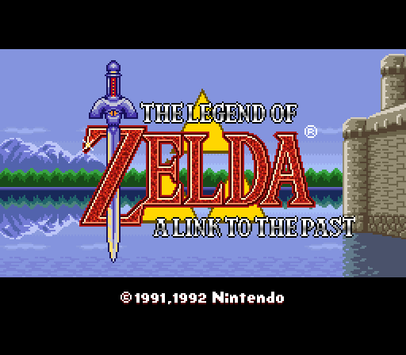
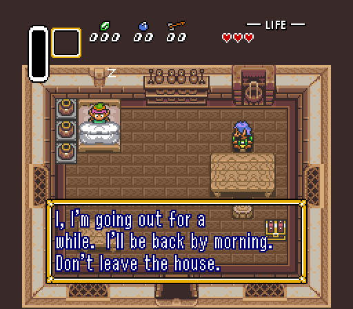
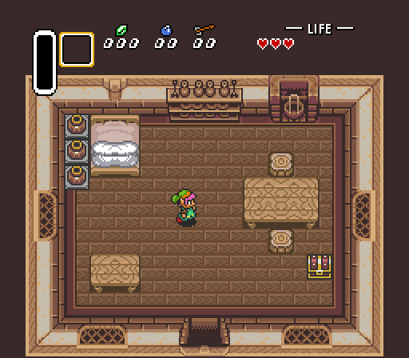

# Bringing a decompiled game to the engine

The steps are in order. `docs/api.md` is the full contract, `examples/comet` a complete small game on it, and section 8 walks
through zelda3.

## 1. Find every hardware touch

`tools/nshvc-find-hardware src/` lists each one with its replacement.

## 2. The hardware and the calls that replace it

| On the SNES | On the engine |
|---|---|
| Reset vector, main loop | `nshvc_game`, `nshvc_run` |
| NMI handler's game logic | `update` |
| NMI handler's uploads | `draw`, or object writes when the data changes |
| Waiting for vertical blank | Return from `update` |
| IRQ on a line, H-blank write | `nshvc_line`, `nshvc_line_from` |
| BGMODE, BGnSC, BGnNBA, scroll | `nshvc_mode_set`, `nshvc_layer_set` |
| TM, TS | `enabled_main`, `enabled_sub`; bit 4, the sprites, is `nshvc_sprites_show` |
| M7A to M7D, M7X, M7Y, M7SEL | `nshvc_mode7_set` |
| Window registers | `nshvc_windows_set` |
| CGWSEL, CGADSUB, COLDATA | `nshvc_blend_set` |
| INIDISP | `nshvc_screen_set`: `brightness`, `blank` |
| The television's shape | `nshvc_screen.aspect`: 0 is 4:3 for 256 x 224 |
| DMA to VRAM | `nshvc_tiles_write` (`NSHVC_TILES_PLANAR` takes the data as it is), `nshvc_map_write_snes` |
| DMA to CGRAM | `nshvc_palette_write` |
| OAM buffer | `nshvc_sprites_set` |
| HDMA tables | `nshvc_lines` |
| Joypad registers | The `nshvc_input` passed to `update` |
| APU ports | `nshvc_music_send`, read by your music code with `nshvc_music_receive` |
| Sound driver | Music code in `nshvc_music.tick`, calling `nshvc_voice_*` |
| Super FX or other chip | C that fills an `nshvc_draw_list` |
| Battery RAM | `nshvc_save_write`, `nshvc_save_read` |
| ROM data | `nshvc_asset_open`, or data compiled in |

Multiplier, divider, H and V counters: use ordinary C.

## 3. Rules for music code

`nshvc_music.tick` runs on the audio thread. It must never wait, lock, allocate, do file work or block. It reaches the game
only through the one-way queue.

## 4. Clean up

Replace the `cpu` register file, flag helpers and data at SNES addresses with ordinary C in the same pass. The engine never
sees this code, but shared register state stops a game using threads.

## 5. Pacing

A game whose speed came from how long its work took must set that speed in its own code. The engine has no console speed.

## 6. Build

Your `CMakeLists.txt` adds the engine from `NSHVC_ROOT`, which `tools/nshvc-build` sets, and calls `nshvc_game()`:

```cmake
cmake_minimum_required(VERSION 3.20)
project(mygame C)
add_subdirectory(${NSHVC_ROOT} nshvc)
include(${NSHVC_ROOT}/cmake/NshvcGame.cmake)
nshvc_game(mygame SOURCES src/a.c src/b.c ASSETS data SHADERS shaders TITLE "My Game")
```

Building a game with shaders needs `glslangValidator`, `spirv-cross` and `dxc` on the build machine.

Then run this, or name `ios`, `android`, `windows`, `windows-d3d12` or `linux` instead:

```bash
tools/nshvc-build macos path/to/game
```

## 7. Check

Run the game headless and compare what it shows and plays with the original running in bsnes:

```bash
game --headless --updates 600 --input inputs.txt --sound out.raw
```

`inputs.txt` has one line per change: the update number, then each pad's buttons in hex.

`tools/nshvc-check` does the comparison: it plays the ROM in bsnes and the game headless with the same `inputs.txt`, and compares chosen frames pixel by pixel and, with `--sound`, the sound sample by sample:

```bash
tools/nshvc-check --oracle build/tests/oracle --core bsnes_libretro.dylib --rom game.sfc --game "build/game" --input inputs.txt --at 60,600,1800 --sound
```

## 8. Worked example: zelda3

[zelda3](https://github.com/snesrev/zelda3) is a decompilation of about 80,000 lines of C. It has been run on the engine as its
first full game, to test the engine. It has a window, input, picture and music on the engine, and shows what the boundary
between a decompilation and the engine looks like. You supply your own ROM, from which the project extracts its game data.

The bridge is in [`examples/zelda3`](../examples/zelda3), with the steps to build it. These pictures are the engine's own output, drawn through its API:

| Title screen | A text box | Play |
|---|---|---|
|  |  |  |

zelda3 already keeps the SNES's hardware state in C structures of its own, so it was first brought up with a small bridge at
that boundary. A bridge is the quick way to run a game and test the engine. A finished conversion goes further and calls the
engine directly from the game's code, as sections 1 to 4 describe.

**The game's entry.** The game's frame function and its setup replace the front end it came with:

| zelda3 | On the engine |
|---|---|
| `main`, its SDL window and loop | `nshvc_game` and `nshvc_run` |
| Loading `zelda3_assets.dat` and setting the language | `init`. The dialogue data is set here too, or the text boxes are empty |
| `ZeldaRunFrameInternal(input, 3)` | `update`, at 60 a second |
| `ZeldaDrawPpuFrame` | `draw`, in place of the game's line renderer |
| Its joypad word, B in bit 0 | The bits of `nshvc_input.pad[0]`, reversed |

**The picture.** In `draw`, the game's state becomes engine calls once per picture:

| zelda3's state | On the engine |
|---|---|
| `vram` at each layer's tile address | `nshvc_tiles_write` with `NSHVC_TILES_PLANAR`, 2 bpp for BG3 and 4 for the others |
| `vram` at each tilemap address, one to four 32 x 32 screens | `nshvc_map_write_snes` into a map of that size |
| The sprite tile addresses, two tables of 256 | One tile set of 512 |
| `vram`'s low and high bytes in Mode 7 | A Mode 7 map and `NSHVC_TILES_MODE7` tiles |
| `oam` and its high table | `nshvc_sprites_set`, with 9-bit X and Y above 223 made negative |
| `screenEnabled` | `enabled_main`, `enabled_sub`, and `nshvc_sprites_show` |
| `windowsel`, `screenWindowed` | `nshvc_windows_set`. The SNES's bits are in a different order from `NSHVC_WIN1` and its neighbours |
| `clipMode`, `preventMathMode`, `halfColor` and the rest | `nshvc_blend_set`; `use_fixed` is the opposite of `addSubscreen` |
| `cgram` | `nshvc_palette_write` |

**Changes during the picture.** The game's HDMA tables and its line interrupt change state between lines. Step through them
line by line, set the picture from the state at the first line, and for each later line send what changed with `nshvc_line`:
scrolls, windows, the fixed colour, brightness, Mode 7's matrix, layers on and off, and blending. A state change after line
`i` applies to picture line `i`.

**Music.** zelda3's sound driver is already C, so it becomes the game's music code:

- `nshvc_music.tick` runs one step of the driver, 500 times a second, the rate the driver's timer ran at.
- Each write the driver makes to a DSP register becomes a voice call: volume, pitch, ADSR or gain, key on and off, noise, echo
  and pitch modulation.
- Samples are loaded on the game thread with `nshvc_sample_load` whenever the game uploads a sound bank, by reading the sample
  directory. Key on then picks from that table.
- The audio thread must never wait. While the game thread changes the driver's memory it sets a flag, the tick returns at once,
  and only the game thread waits.

**What it showed.** 284 frames sampled across the intro, menus and 200 seconds of play match the game's own renderer within
rounding. The run also found what the feature scenes had not: the engine drew sprites on the sub-screen when the game had not
asked for it. The fix went into the engine, with new scenes, because the engine must be right for every game. Do the same when
your game shows a difference: find out whether the game's conversion or the engine is wrong, and fix it where it belongs.

Its music follows the game's own sound chip in loudness and shape, not sample for sample. Its frame timing differs from the
ROM's, because the C does not model the original's slow frames, so frames were compared with its own renderer rather than bsnes.
