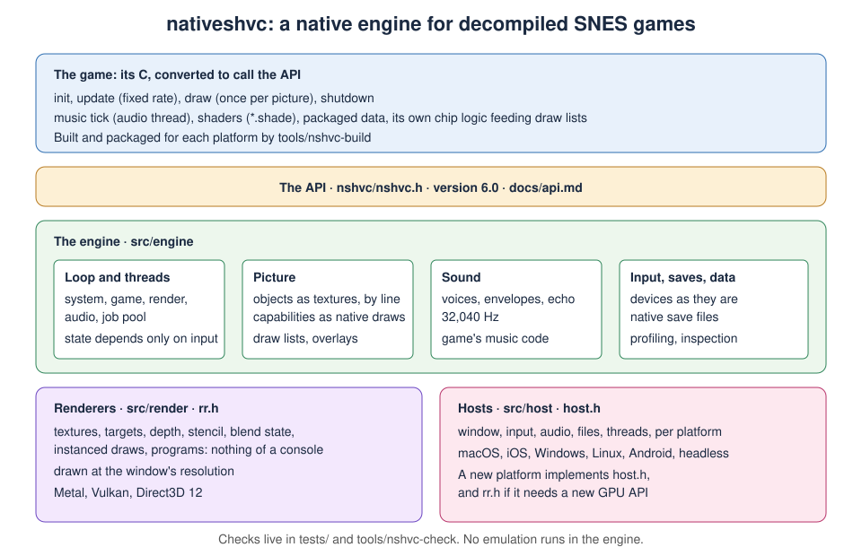

# How the engine is built

- `src/engine`: the loop and threads (`loop.c`), jobs (`jobs.c`), the picture calls and their objects (`picture.c`), the
  picture's capabilities as the renderer's draws (`compose.c`) and the programs they draw with (`shaders/`, GLSL), sound
  (`sound.c`), input (`input.c`), saves and game data (`files.c`), inspection (`inspect.c`).
- `src/render`: the renderer (`rr.h`): textures, render targets, depth, stencil, blend state, instanced draws and
  programs, knowing nothing of any console, on Metal, Vulkan and Direct3D 12. `shaders/build.sh` compiles the programs from
  their one GLSL source into each backend's form (`rr_spv.h`, `rr_msl.h`, `rr_dxil.h`).
- `src/host`: what each operating system supplies, through `host.h`.
- `src/dsp`: the resampler.

**Threads.** The system thread owns the window and events. The game thread runs `update` and `draw`, the render thread draws
each finished picture, the audio thread mixes voices and runs the game's music code, and jobs run on a pool. `update` runs at the game's rate, catching up at most 0.25 seconds; `draw` runs when the renderer is free.

**A new platform** implements `host.h`, and `rr.h` if it needs a new GPU API. Nothing else changes.

**What crosses to the GPU.** Tile sets, maps, images and the palette are textures on the GPU, and a picture sends only the
texels that changed since the last. `draw` sets the whole picture and nothing carries over but those objects, the palette
and the overlays. `compose.c` turns what `draw` set into a frame for the renderer: its passes and their draws, the words
the draws read, and their uniforms. A picture is one pass into the window: the main screen is drawn
into a multisampled target with depth and stencil at the window's size and resolved straight into the window's drawable,
with the black outside the part shown and the overlays in the same pass. The colour maths, brightness and blanking are
done exactly where each layer's colour is written, from the other screen's pixel; the sub screen (and, on hires rows, the
main alone) is drawn into a target of its own first, only on pictures whose maths need it. A draw list that asks for
fewer samples than the picture has is drawn first into a side target of its own and placed where its layer is. An
interlaced picture is the one that keeps state: the screen is drawn into the frame, this field's half-rows of it are
copied into the picture kept from before, and the picture is copied into the window. A frame is kept for `rr_read`,
which runs its passes again into a texture, so nothing is kept or copied for a picture nobody reads. Where the display is
turned from the picture (a phone held sideways), every window-sized target is drawn turned, in the vertex stage.

**The picture's shape.** The viewport places the picture in the window (`rr_view`): 4:3 by default, centred with black
margins, or the shape `nshvc_screen.aspect` names. Everything is drawn at the window's pixels. Overlays are placed in
window pixels and can use the margins.

**Checks live outside the engine.** `tests/` and the bsnes oracle hold the test machinery; `src/` holds none of it. A check that
finds the engine wrong is fixed in the engine for every game, never by a change for one game.

**The preservation standard.** The assembly and proven C are the record, and the native game is built from them on the
engine.
