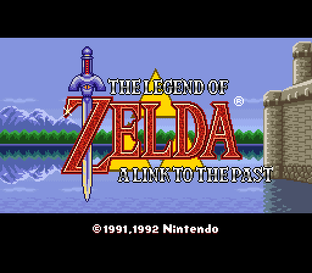
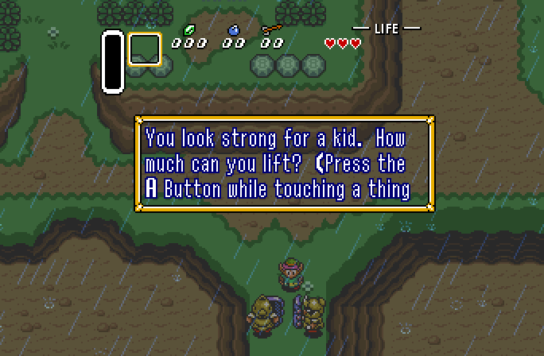

# zelda3 on nativeshvc

A complete game running natively on the engine: a converted copy of [zelda3](https://github.com/snesrev/zelda3), a decompilation of The Legend of Zelda: A Link to the Past in about 80,000 lines of C. It is here as a proven example of what a game looks like on nativeshvc, and how it uses the API.

| Original 4:3 | Widescreen 16:9 |
|---|---|
|  |  |

## Credit

The game's C code, data tools and decompilation are the work of **[snesrev](https://github.com/snesrev)** and the contributors to [snesrev/zelda3](https://github.com/snesrev/zelda3). This copy is based on commit `45a149d` and keeps that project's MIT licence, in [LICENSE.txt](LICENSE.txt). That licence covers this folder; the engine itself is AGPL-3.0. The game itself is Nintendo's. No ROM or game data is included.

## What was changed

The game logic is unchanged. Its imitation SNES hardware (PPU, DMA, DSP, APU), SDL front end, OpenGL code, snapshots and MSU audio are removed. The game now calls the engine directly:

| File | What it does |
|---|---|
| `src/game.c` | The entry point: `nshvc_game`, the update and the draw |
| `src/controls.c` | The game's controls, from the devices the engine reports |
| `src/video.c` | Tile sets, maps, and the description of each picture |
| `src/spc_player.c`, `src/audio.c` | The sound driver, on engine voices from the audio thread |
| `tests/check.c` | Hooks for checks: a picture hash, and starting a section of the game |

`docs/conversion-guide.md`, section 8, explains how it was done.

## Build and run

You need your own USA ROM, and Python 3 with Pillow and PyYAML (`requirements.txt`). Put the ROM at `assets/zelda3.sfc`, then from `assets`, extract the game's data:

```bash
python3 restool.py --extract-from-rom --rom "$PWD/zelda3.sfc"
```

Move the resulting `zelda3_assets.dat` into `data/`, then from the root of this repository:

```bash
tools/nshvc-build macos examples/zelda3
```

The same command builds for `linux`, `windows`, `windows-d3d12`, `android` and `ios`. Set `ZELDA3_ASPECT=16:9` when running to use a widescreen view.

## Controls

The engine reports each device as it is, and the game decides what it does. `src/controls.c` turns them into the joypad word the game reads:

| SNES | Keyboard | Controller |
|---|---|---|
| D-pad | Arrow keys | D-pad or left stick |
| B, A, Y, X | Z, X, A, S | The face buttons by place: bottom, right, left, top |
| L, R | Q, W | The shoulder buttons |
| Start, Select | Return; Shift or Tab | Menu; View |

On a touch screen the game draws its own discs, once a finger has touched the screen, and a finger on one presses it.

## What has been tested

macOS was built and played. Linux, Android and iOS (Simulator) and Windows (under Wine) ran the same check and drew the same pictures. See `docs/native-engine-plan.md` for what has and has not been run.
